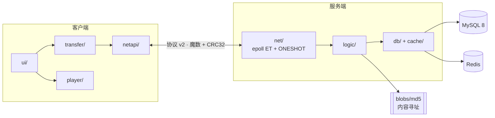

# cloud-media

**Windows Qt 客户端 + Linux 自研 Reactor 服务端**的云盘与在线播放系统：二进制协议 v2、
内容寻址存储，支持秒传、断点续传、分享、回收站与**边下边播**。

```text
服务端  C++11 · epoll(ET + ONESHOT) · 自研线程池 · MySQL 8 · Redis 7 · sendfile
客户端  Qt 5.12(32 位) · QTcpSocket 独立网络线程 · FFmpeg 4.2.2 解码 · SDL2 音频
交付    CMake(3.5 语法) · Docker 多阶段 · docker compose · windeployqt · ctest 44 项
```

## 功能

- **上传**：4MB 分片、秒传（同 MD5 0 字节）、坏片重传、断点续传（暂停后继续走服务端位图，只补缺口）
- **下载**：4 连接分块、断点续传（`.part.state` 位图）、sendfile 零拷贝、连接级/用户级令牌桶限速
- **文件**：目录分页 + 面包屑、拖拽上传、回收站（软删/恢复/彻底删除）；文件夹删除只软删目录节点，恢复整树回来，彻底删除才级联
- **分享**：分享码 + 提取码 + 过期时间；接收方可**转存到我的网盘**（10044/10045，只加引用计数不搬字节）或下载到本地
- **播放**：双击视频边下边播，首块起播、暂停/seek/音量/全屏（独立全屏窗口 + DPI 正确），GL 与 QPainter 双渲染后端
- **传输**：边下边播任务按文件去重、缓存命中「已缓存 · 秒开」；断线无限退避重连，状态栏一键重连
- **运维**：Docker 一键起（mysql + redis + server）、CLI 冒烟、异步日志

## 架构



分层、上传时序、边下边播时序与 10 条关键决策见 **[docs/架构总览.md](docs/架构总览.md)**。
依赖红线：`ui/` 不碰 FFmpeg/SDL，`common/` 不碰 Qt/socket，`client/` 不依赖 `server/`（CI grep 卡）。

## 性能（2 vCPU / 4GB，回环，未含公网带宽）

| 指标 | 结果 | 条件 |
|---|---|---|
| 上传吞吐 | **35.3 → 86.7 MB/s（2.46×）**，P99 11.59s → 6.65s | 10MB × 100 并发，64 在途 |
| 下载（裸能力） | **522 MB/s**，CPU 15% | 10MB × 100，未限速 |
| 下载（限速生效） | 单流 2.0MB/s，4 流聚合 7.6MB/s | 连接级 2MB/s + 用户级 8MB/s |
| 列表 | **4310 QPS** | c=1000 持续 60s |
| 长连接 | **8000 条稳定 30s，RSS 41.7MB** | connect storm 1920 conn/s |

完整数据与火焰图：`docs/benchmark/压测报告.md`。

## 5 分钟跑起来

只装 **git + docker**：

```bash
git clone <repo-url> cloud-media && cd cloud-media
scripts/deploy.sh            # build → up → 等 8004 → 上传/下载/MD5 冒烟 → DEPLOY_OK
```

- 服务端：`http://127.0.0.1:8004`（宿主端口冲突就改 `docker-compose.yml` 的 `ports`）。
- 演示账号：`13900000000 / demo123456`（**仅演示**）。
- 构建 + 全量测试（含 MySQL/Redis 集成）：`docker compose --profile test run --rm build-test`。
- 停服：`docker compose down`（`down -v` 会清库）。

客户端（Windows + Qt 5.12 mingw73_32，路径用 `<QT_ROOT>`，本机具体值见
`docs/plans/phase-8.md`）：

```bash
cmake -S . -B build-client -G "MinGW Makefiles" \
  -DBUILD_SERVER=OFF -DBUILD_CLIENT=ON -DCMAKE_PREFIX_PATH=<QT_ROOT>/5.12.11/mingw73_32
cmake --build build-client -j8
build-client/bin/cloud-media-client.exe --host <server-host> --port 8004 \
  --tel 13900000000 --password demo123456
```

客户端依赖/打包细节见 `client/README.md`；全链路与打包自检：`scripts/e2e_p8.sh`、
`scripts/package_client.sh --verify`。

## 测试与 CI

- 单元/集成：**ctest 44 项**（Linux，`BUILD_SERVER+BUILD_STORAGE+BUILD_TESTS+ENABLE_DB_INTEGRATION_TESTS=ON`），
  含 MySQL 池、Redis 池、存储集成、协议编解码、Reactor、业务服务；Windows 客户端另有 5 套（netapi/transfer/sqlapi/flow/ui）。
- CI：GitHub Actions `.github/workflows/ci.yml`（ubuntu-22.04 + MySQL 服务容器 + Redis），
  跑 C++11 红线检查、构建、ctest 与覆盖率门槛。

## 文档

| 类别 | 文档 |
|---|---|
| 总览 | [docs/架构总览.md](docs/架构总览.md) |
| 设计 | [01 架构](docs/specs/01-架构设计.md) · [05 存储](docs/specs/05-存储设计.md) · [06 业务](docs/specs/06-业务设计.md) · [08 界面契约](docs/specs/08-界面设计契约.md) · [09 播放器](docs/specs/09-播放器设计.md) |
| 计划 | [phase-8 客户端](docs/plans/phase-8.md) · [phase-9 播放器](docs/plans/phase-9.md) · [phase-10 交付](docs/plans/phase-10.md) |
| 压测 | [压测报告](docs/benchmark/压测报告.md) · [数据库性能](docs/benchmark/数据库性能.md) · [日志性能](docs/benchmark/日志性能.md) |
