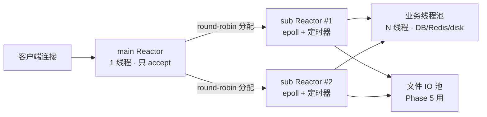
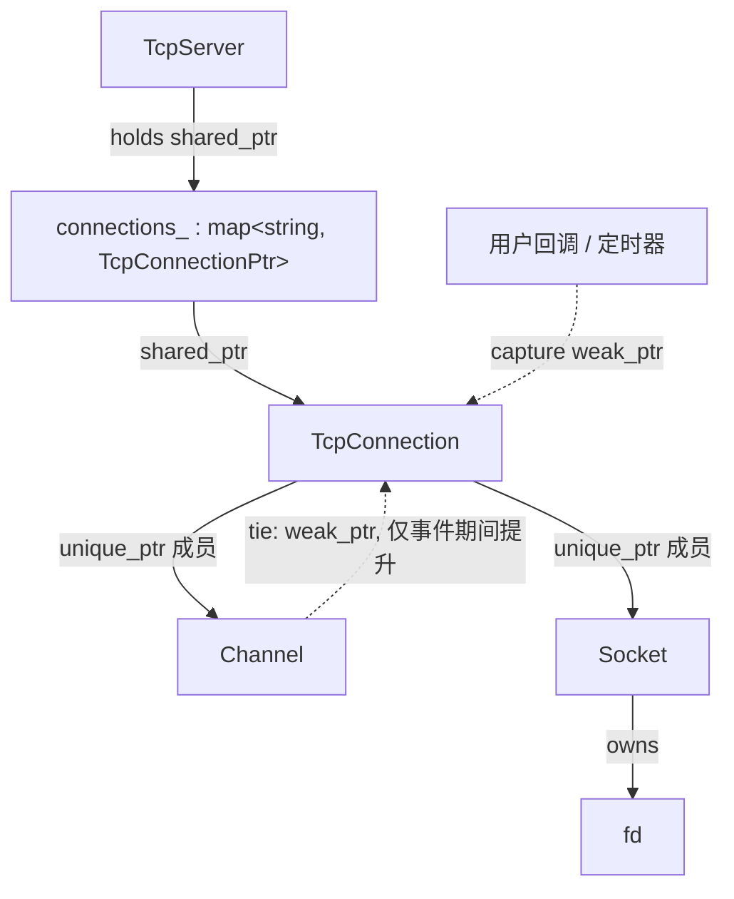

# 04 · 服务端网络层设计（Reactor / epoll / 连接生命周期 / 定时器 / 优雅退出）

> 阶段：**Phase 3 — 服务端网络层升级**
> 视角：architect，**只定方案，不写实现**。本文是后续 `writing-plans` 的输入，也是 Phase 10「面试问答」的素材底稿。
> 目标环境：**Ubuntu 16.04 / kernel 4.4 / glibc 2.23 / g++ 5.4 / cmake 3.5**
> 约束：纯 C++11（禁 C++14/17）、禁止裸 `new/delete` 管资源、CMake 不高于 3.5、**可执行产物统一输出到 `build/bin/`**。

## 0. 输入与前提

`docs/specs/01-架构设计.md` 与 `legacy/server/linux-epoll` 源码**仍未落到本仓库**，旧系统形态按路线图 §0 的盘点取值；网络层代码已按本文落地（见 §13 对照表），因此本文同时承担「设计依据」与「实现验收基线」两个角色。

| 假设项 | 取值 | 依据 |
|---|---|---|
| 旧服务端 | epoll + 线程池 + MySQL C API，私有二进制协议 10000~10029，无连接池/无定时器 | 路线图 §0 |
| 旧连接管理 | 裸 fd + 手写结构体 + `memset` 初始化，无 RAII | 路线图「技术债」 |
| Phase 3 范围 | **只做网络层**：accept / 收发 / 连接管理 / 定时器 / 退出；业务在 Phase 5 | 路线图 §6 |
| 并发目标 | Phase 3 echo 2000 连接稳定 10 分钟；Phase 7 冲 5000~8000 | 路线图 Phase 3 / §1 |
| 协议 | v2 codec 在 Phase 2 已就绪，网络层只认「字节流 + 完整包回调」 | 路线图 Phase 2 |
| 部署形态 | 2C4G 云主机，单进程 | 路线图 §11.1 |
| 产物路径 | 全部可执行文件输出到 `build/bin/` | 根 `CMakeLists.txt` 的 `CMAKE_RUNTIME_OUTPUT_DIRECTORY` |

命名沿用 muduo 风格（`EventLoop / Channel / Poller / TcpConnection / Acceptor`），便于与主流资料对照，也便于讲清楚。复用件不重复造：字节缓冲与线程池放在 `common/base/`，服务端与将来的客户端共享。

---

## 1. 结论速览

| 议题 | 结论 | 一句话理由 |
|---|---|---|
| Reactor 模型 | **主从 Reactor**：main（只 accept 分发）+ N 个 sub（各持一个 epoll）+ **独立业务线程池** + **独立文件 IO 池**；`N = min(4, cpu)` 可配置，**默认 1 也能跑**（Phase 3 先单 loop 交付，见 §13） | 2000 连接单 Reactor 扛得住，但网盘一次 4 段并发下载就能把单事件循环堵死；分层现在做，扩容只改配置 |
| 事件语义 | `EPOLLIN \| EPOLLET \| EPOLLONESHOT \| EPOLLRDHUP`；写事件按需单独武装 | ET 减少无效唤醒；ONESHOT 把「同一连接同一时刻只被一个线程处理」变成**内核保证**，省掉连接级锁 |
| 连接生命周期 | `shared_ptr<TcpConnection>` + `enable_shared_from_this` + `Channel::tie(weak_ptr)`；关闭走 shutdown → 等 FIN/超时 → forceClose → **queueInLoop 延迟析构** | 析构绝不能发生在事件回调栈里，否则 poller 迭代 activeChannels 时对象被释放 |
| 定时器 | **min-heap（std::set）+ timerfd**；**心跳不做成「每连接一个堆定时器」**，用 tick + `lastActiveAt` 扫描 | 万级连接下每包一次堆操作的收益为负；扫描 10000 个时间戳约 50μs/次，成本可忽略 |
| 优雅退出 | 停 accept → 连接 drain/shutdown → 停业务池 → 停子 Reactor → 清连接表 → 关资源池 → flush 日志；signal 用 **self-pipe** | 顺序错了就是「线程还在用池，池已析构」的段错误；handler 里只做一次 `write`，async-signal-safe |

---

## 2. Reactor 模型选型

### 2.1 候选方案

| 方案 | 结构 | 优点 | 缺点 |
|---|---|---|---|
| **A. 单 Reactor + 工作线程池** | 1 个 loop 线程负责 accept/读写/定时器；业务（DB、Redis、文件）抛线程池 | 代码最少、无跨线程投递、无连接所有权转移，调试最简单 | loop 线程是单点：任何「在 loop 里做重活」的失误都会卡住全部连接；转发大文件时单核打满 |
| **B. 主从 Reactor（main-sub）** | main 只 accept；N 个 sub 各跑一个 loop/一个 epoll，连接**按分配绑定**到某个 sub；业务另走线程池 | 天然多核扩展；大流量连接分散到多核；单连接仍单线程，无锁 | 跨线程投递（eventfd 唤醒）、连接所有权转移、退出顺序更复杂 |
| **C. 多进程 + SO_REUSEPORT** | 每进程一套 Reactor | 隔离性最好（nginx 模型） | 连接级状态/会话/文件句柄无法共享，本项目无此需求，复杂度纯亏 |

### 2.2 结合「2000 连接 echo + 后续网盘业务」的量化判断

**echo 场景（Phase 3 验收）**：2000 个长连接，若每连接 50 QPS 小包，总事件量约 10 万次/s。单 loop 每轮 `epoll_wait` 取 64 个事件、每次事件约 2~4 μs（含两次 syscall 与回调），单核大约能跑 10 万~20 万 echo/s —— **2000 连接刚好在单核能力边缘**，能过验收，但没有余量，Phase 7 的 5000~8000 目标必然不够。

**网盘业务（Phase 5 起）的真实负载结构**：

| 业务 | 在 loop 线程里的开销 | 单 Reactor 后果 |
|---|---|---|
| 分片上传 4MB/片 | 收包 + CRC32（4MB 约 3~8ms CPU） | 这几毫秒内**所有连接**停摆，P99 直接飙 |
| 分片合并写盘 | 若不投池，几十 MB 写盘 = 数十 ms | 事件循环完全冻结 |
| 下载 sendfile | 单连接可连续写满带宽 | 一个用户下 1GB 就把一个核吃干 |
| MySQL/Redis 调用 | 若在 loop 里 = 阻塞几十 ms | 灾难 |
| 客户端 4 段并发下载 × 多用户 | 并发连接数线性上升 | 单核必然成为瓶颈 |

**结论：选 B（主从 Reactor）**，但按「**可退化为 N=1**」的方式实现：

1. `TcpServer` 的连接创建**按「可注入 loop」设计**（连接对象必须在所属 loop 线程内构造），`N` 来自 `server.ini` 的 `io_threads`；Phase 3 先用单 loop 打通，池子在 Phase 5/7 接入（见 §13）；
2. `io_threads = 0/1` 时行为等价于单 Reactor（所有连接在 main loop），**便于先用单线程把 ET/ONESHOT 逻辑调对**；
3. 生产默认 `min(4, cpu)`（2C4G 上就是 2）；
4. 因为 A、B 共用 `EventLoop/Channel/Poller/TcpConnection` 全套抽象，**从 A 切到 B 只改一个配置项，不改业务代码**——这就是选 B 却不必现在就承担全部复杂度的原因。

### 2.3 三层线程模型（对外只暴露一层）



| 线程 | 数量 | 允许做的事 | **禁止做的事** |
|---|---|---|---|
| main Reactor | 1 | `accept4`、构造 `TcpConnection`、转交 sub | 任何读写业务、任何阻塞调用 |
| sub Reactor | `io_threads` | 该组连接的全部读写、编解码、定时器、发包队列 | 磁盘 IO、DB/Redis、CRC 大块计算、**join 线程** |
| 业务池 | `worker_threads`（默认 cpu×2） | 协议业务、DB/Redis、分片落盘 | 直接操作 fd、直接写 `TcpConnection` 的 buffer |
| 文件 IO 池 | 固定 2~4 | 分片合并、`read` 大文件 | 触碰连接状态 |

> 上图是**目标形态**。Phase 3 的交付物是「main loop 内完成 accept + 收发」的单 loop 版本，`EventLoopThread` 已具备、分发池在 Phase 5/7 接入；单连接仍严格绑定一个 loop，跨线程规则从一开始就成立，所以切换时业务代码不动。

**跨线程调用规则（写死）**：非绑定线程想操作连接，只能 `conn->getLoop()->runInLoop(...)`；`EventLoop::runInLoop` 内部用 `eventfd` 唤醒，保证 `TcpConnection` 的所有状态变更都在其所属 loop 线程内完成（**单线程化状态机**，不需要给每个连接加锁）。

### 2.4 模块与文件划分

```
server/net/
├── EventLoop.{h,cpp}          # loop 本体 + runInLoop/queueInLoop + eventfd 唤醒
├── EventLoopThread.{h,cpp}    # loop + std::thread 绑定，startLoop() 返回即就绪
├── Channel.{h,cpp}            # fd + 关注事件 + 回调；tie(weak_ptr)
├── Poller.{h,cpp}             # 抽象基类 + 平台无关事件位掩码
├── EpollPoller.{h,cpp}        # epoll_create1/ctl/wait；非 Linux 编译空实现
├── Socket.{h,cpp}             # fd 的 RAII 所有者 + accept4（peer 输出 "ip:port"）
├── Acceptor.{h,cpp}           # listen fd + accept 循环 + EMFILE 退避
├── TcpConnection.{h,cpp}      # 连接状态机、读写路径、背压
├── TcpServer.{h,cpp}          # 连接表（唯一 owner）+ 回调装配 + 优雅/强制关闭
├── TimerQueue.{h,cpp}         # 最小堆 + timerfd（TimerId 同头文件）
├── SignalHandler.{h,cpp}      # self-pipe
└── Callbacks.h                # std::function 别名 / Timestamp

common/
├── base/buffer.{h,cpp}        # 可读写索引 + readv 64KB 栈缓冲（读到 EAGAIN）
├── base/thread_pool.{h,cpp}   # std::mutex + condition_variable，停机排空队列
└── memory.h                   # makeUnique（C++11 没有 std::make_unique）
```

**与初版的差异（都是减复杂度，不是漏做）**：

| 初版 | 现状 | 理由 |
|---|---|---|
| `EventLoopThreadPool` | **未实现**，`TcpServer` 单 loop | Phase 3 无业务分流需求；多 sub 是「配置项打开才生效」的增量，接口已按可切换方式预留 |
| `Buffer` 在 `server/net` | 移到 `common/base/` | 客户端 Phase 8 也要用同一份缓冲实现，避免两套 |
| `InetAddress` | 合并进 `Socket`，对端地址直接产出 `"ip:port"` | 本阶段只需对端地址做连接命名，独立类属过度设计 |
| `ThreadPool` | 独立 `cloud::ThreadPool`，不接管连接回调 | Phase 3 无 DB/磁盘活；现在接成「echo 丢池」只会破坏单连接事件顺序 |

**明确不做**（防止范围蔓延）：不做 UDP、不做 TLS、不做 SO_REUSEPORT 多进程、不做用户态协议栈、不引入 boost.Asio。Phase 3 只交付 TCP + 定时器 + 退出。

---

## 3. epoll ET + EPOLLONESHOT 事件流

### 3.1 为什么是 ET + ONESHOT

| 组合 | 行为 | 问题 |
|---|---|---|
| LT | 水平触发，没读完还会再通知 | 多线程下同一 fd 可能同时被多个线程处理 |
| ET 无 ONESHOT | 只在状态变化时通知 | 多 sub Reactor 共享 epoll 时会惊群；跨线程处理同一连接要加锁 |
| **ET + ONESHOT** ✅ | 触发一次后内核自动摘除该 fd 的监听，`EPOLL_CTL_MOD` 才重新武装 | 「一个连接同一时刻只在一个线程里被处理」由内核保证，连接状态机天然无锁 |

**注意**：`EPOLLEXCLUSIVE` 需要 kernel ≥ 4.5，**Ubuntu 16.04 是 4.4，不可用**；本项目每个 sub Reactor 独占一个 epoll fd，本来也不存在多线程共享同一 epoll 的惊群问题。

### 3.2 关注事件集

```
EPOLLIN | EPOLLET | EPOLLONESHOT | EPOLLRDHUP      // 连接建立即注册
EPOLLOUT | EPOLLET | EPOLLONESHOT                 // 仅当输出缓冲非空且上次写遇到 EAGAIN 时追加
```

- `EPOLLRDHUP`（2.6.17+）用于更早感知对端半关闭，避免只依赖 `read==0`；
- 不用 `EPOLLERR/EPOLLHUP` 注册（内核总是上报），只在回调里判 `revents & (EPOLLERR|EPOLLHUP)` 走 `forceClose`；
- 一律 `EPOLL_CTL_MOD` 增减关心的事件，**不反复 ADD/DEL**。

### 3.3 读事件：一次读到 EAGAIN

```
handleRead():
  1. assertInLoopThread()
  2. 循环 recv(fd, buf, 64KB, 0)          // 栈上 64KB extrabuf，配合 readv 减少 buffer 扩容
       n > 0  -> inputBuffer.append(buf, n)，继续循环
       n == 0 -> 对端 FIN：先处理完 inputBuffer 里已收完的完整包，再 handleClose()
       n < 0  -> EINTR        : continue
                 EAGAIN/EWOULDBLOCK : break        ← ET 的终止条件，必须到达这里
                 ECONNRESET/EPIPE   : forceClose(); return
  3. 循环从 inputBuffer 取「完整包」（codec 判定长度）
       每取到一个包：**先 copy/move 出 buffer**，再投递业务池（跨线程的只传数据 + weak_ptr）
  4. 若 inputBuffer 里残留半包 -> 保留，等待下次事件
  5. 末尾统一调用一次 rearm()
```

**必须在一次事件里读到 EAGAIN**，否则 ET 不会再通知，连接会「假死」。旧代码的通病是「读一次就返回」，这是 ET 化最容易踩的坑。

### 3.4 ONESHOT 重新武装：5 条硬规则

| # | 规则 | 违反后果 |
|---|---|---|
| 1 | 只在**连接所属 loop 线程**内武装（`assertInLoopThread`） | `epoll_ctl` 与连接状态竞争，随机丢事件 |
| 2 | **每次事件只武装一次**，放在 `handleEvent` 结尾，不在读循环中间调 | 重复 MOD 导致同一事件被投递两次 |
| 3 | **先取走数据、再武装、最后异步派发** | 武装后新数据可能被另一个线程处理，与当前线程共用 inputBuffer → 数据错乱（ONESHOT 只保证事件不并发，不保证你的 buffer 安全） |
| 4 | 正在关闭 / 已 `forceClose` 的连接**不再武装**，直接走 remove | 关闭后 fd 可能被复用，重新武装会监听到别人的 fd |
| 5 | 输出缓冲超过高水位（默认 8MB）时**暂不武装 EPOLLIN**（背压），等写空到低水位（2MB）再武装 | 对端不收数据时内存被撑爆 |

**背压的实现要点**：`highWaterMark` / `lowWaterMark` 由 `server.ini` 配置；停止读取期间连接状态保持 `kConnected`，只是不监听 `EPOLLIN`；写空触发 `lowWaterMark` 时补一次 `rearm()` 重新打开读。

### 3.5 写事件：按需武装 + 一次写完

```
send(data)  [任意线程]
  └─ runInLoop(sendInLoop)                       // 切回 loop 线程
       ├─ 输出缓冲为空 且 无 pending sendfile：
       │     n = ::send(fd, data, len, MSG_NOSIGNAL)   // MSG_NOSIGNAL 防止 SIGPIPE 杀进程
       │     n == len          -> 完成，**不注册 EPOLLOUT**
       │     0 < n < len       -> 剩余入 outputBuffer，enableWriting()
       │     EAGAIN            -> 全部入 outputBuffer，enableWriting()
       ├─ 输出缓冲非空：append + enableWriting()
       └─ 大块发送（Phase 5 的 sendfile）：切片 1MB/轮，避免饿死同 loop 的其他连接

handleWrite():
  1. 若存在 sendfile 待发：循环 sendfile() 直到 EAGAIN 或切片用完
  2. 否则从 outputBuffer 取数据 send()，循环到 EAGAIN
  3. 写完（buffer 空 且 无 pending file）：
       disableWriting()            // EPOLL_CTL_MOD 去掉 EPOLLOUT
       若此前因背压停读 -> 恢复 EPOLLIN
  4. 若状态是 kDisconnecting 且 buffer 已空 -> shutdownWrite() -> 等待对端 FIN
  5. 末尾 rearm()
```

**关键点**：ET 下**绝不能常驻 `EPOLLOUT`**——socket 可写是常态，常驻会导致 `epoll_wait` 空转 100% CPU（Phase 3 调试期的头号坑，验收里专门查 CPU）。`EPOLLOUT` 只在「有数据但写不出去」时打开，写完立刻关掉。

### 3.6 错误码与分支对照

| 返回值 | errno | 处理 |
|---|---|---|
| `n > 0` | — | append，继续读 |
| `n == 0` | — | 对端关闭：处理完已收完整包 → `handleClose` |
| `n < 0` | `EINTR` | `continue`（信号打断，不算错误） |
| `n < 0` | `EAGAIN/EWOULDBLOCK` | `break`（ET 正常终止） |
| `n < 0` | `ECONNRESET` | `forceClose`，打 WARN 带 traceId |
| `n < 0` | 其他 | `forceClose`，打 ERROR 带 errno 文本 |

### 3.7 Accept

`accept4(fd, ..., SOCK_NONBLOCK | SOCK_CLOEXEC)`（2.6.28+）一次拿到非阻塞 + CLOEXEC，避免 `accept` 后再 `fcntl` 的竞态；`EMFILE/ENFILE` 时不要空转（关闭一个「接受后立即关闭」的备用 fd，或退避 100ms），否则会打满 CPU。

---

## 4. TcpConnection 生命周期

### 4.1 所有权图



- **唯一 owner 是 `TcpServer` 的 `connections_` 映射**，键用 `"ip:port#seq"`（不用 fd，避免 fd 复用后串号）；
- `Channel` 里用 `std::weak_ptr<void> tie_`，`handleEvent` 开头 `tie_.lock()` 提升：保证「事件回调执行期间对象不会被别的线程销毁」，回调结束自动释放。**这是避免悬垂的关键机制**；
- 业务回调、定时器一律捕获 `weak_ptr<TcpConnection>`，用时 `lock()`，**绝不**在 `TcpConnection` 自己的回调里捕获自己的 `shared_ptr`（会形成引用环，永不释放）。

### 4.2 状态机

```
kConnecting ──(connectEstablished)──> kConnected
kConnected ──(shutdown)──> kDisconnecting ──(写空 + 对端 FIN 或超时)──> kDisconnected
kConnected ──(error / RST / 心跳超时 / 服务端退出)──> kDisconnected
```

状态只允许在 loop 线程改，对外只暴露 `send/shutdown/forceClose`，内部用 `std::atomic<bool>` 仅保护「是否已请求关闭」这一布尔。

### 4.3 三条关闭路径，一个出口

| 触发 | 动作 |
|---|---|
| 对端 FIN（`read == 0`） | 处理完残留完整包 → `handleClose` → 摘除 Channel → `queueInLoop` 销毁 |
| 出错 / RST / 心跳超时 / 写超时 | `forceClose`：`shutdown(SHUT_RDWR)` → 立即摘除 → 延迟销毁（丢弃未发数据） |
| 服务端优雅退出 | `shutdown`：停读 → flush 发送缓冲 → `shutdown(SHUT_WR)` → 等对端 FIN 或 deadline → `forceClose` |

**统一出口 `destroy()`**：

```
TcpServer::removeConnection(conn):            // 必须在 loop 线程
    connections_.erase(key);                  // 表里最后一个 shared_ptr 移除
    loop->queueInLoop(std::bind(&TcpConnection::destroyInLoop, conn));   // 关键：延迟

destroyInLoop():
    assertInLoopThread
    channel_->disableAll(); channel_->remove();   // epoll_ctl DEL + 从 poller 的 channel map 摘除
    socket_->close();                             // fd 真正关闭（RAII）
    // 函数返回后，形参 conn 是最后一个引用 -> 此时才析构
```

### 4.4 防悬垂的 7 条硬规则

| # | 规则 | 说明 |
|---|---|---|
| 1 | 禁止在 `handleEvent` 调用栈内析构连接 | 回调栈上还持有 `Channel` 成员，析构 = use-after-free；一律 `queueInLoop` 推迟到下一轮 |
| 2 | `Channel::tie(weak_ptr)` 必须在 `TcpServer` 构造连接后立刻设置 | 覆盖「回调执行中对方调用 forceClose」的窗口 |
| 3 | `shared_from_this()` 只能在对象已被 `shared_ptr` 接管后调用 | 构造函数里调用抛 `bad_weak_ptr`；工厂函数里用 `make_shared` 建好再 `conn->start()` |
| 4 | 关闭后 `fd` 立刻置 `-1` 并 `EPOLL_CTL_DEL` | fd 会被内核复用，残留的 epoll 注册会监听新连接的 fd，产生「幽灵事件」 |
| 5 | 跨线程只传 `shared_ptr`（延长生命周期）或 `weak_ptr`（可失效检测），不传裸指针 | 裸指针在异步窗口里一定出事 |
| 6 | 定时器回调里操作连接必须先 `lock()` 判空 | 连接可能在定时器触发前已销毁 |
| 7 | 禁止 `TcpServer` 析构时仍有连接线程在跑 | 见 §6 退出顺序：先 join 线程，再析构表 |

---

## 5. TimerQueue 选型

### 5.1 对比

| 方案 | 插入/删除 | 触发扫描 | 取消 | 适用 |
|---|---|---|---|---|
| **最小堆（`std::set` 红黑树）** | O(log n) | O(k log n)，k=本轮过期数 | 支持按句柄 O(log n) 删除 | 变周期、异构定时器 |
| `std::priority_queue` + 惰性删除 | O(log n) | O(k log n) + 惰性清理 | 只能标记，内存膨胀 | 只增不删的场景 |
| **单级时间轮** | O(1) | O(1) 分摊 | 需额外哈希表定位槽位 | 周期统一（如全部 60s） |
| **多级时间轮** | O(1) | O(1) 分摊 | 级联降级逻辑复杂 | 10 万+ 定时器、毫秒级精度 |

### 5.2 万级连接的量化

- 10000 个定时器的堆操作：`log2(10000) ≈ 13.3`，一次插入 ≈ 14 次比较 ≈ **0.2 μs**；每秒 1 万次重设也只有 2 ms CPU（占比 0.02%），完全不是瓶颈；
- 时间轮在 n=10^4 量级省下的是「每操作 13 次比较」，换来的是「槽位/级联/取消三套逻辑 + 精度取决于槽宽」——**收益不抵复杂度**；
- 真正决定设计的是：**变周期定时器多**（心跳 90s、鉴权 5s、重试 1s/2s/4s 退避、分享码 TTL、下载直链 TTL、退出 deadline），固定槽宽的时间轮对这些不友好。

**结论：TimerQueue 用 `std::set<TimerEntry>` 最小堆 + timerfd，不引入时间轮。** 升级触发条件写死在文档里：**单 loop 定时器 > 10 万，或需要毫秒级大量变周期定时器时，再上多级时间轮**。

### 5.3 实现要点

| 要点 | 设计 |
|---|---|
| 时钟 | `std::chrono::steady_clock`（对应 `CLOCK_MONOTONIC`），**不用 system_clock**，避免 NTP 校时导致定时器整体漂移 |
| 唤醒 | `timerfd_create(CLOCK_MONOTONIC, TFD_NONBLOCK | TFD_CLOEXEC)` + `TFD_TIMER_ABSTIME`，注册进本 loop 的 epoll；**不依赖 `epoll_wait` 的 timeout 参数**，避免多定时器时反复计算最小超时且受 EINTR 干扰 |
| 超时通知 | 只在「最早到期时间变化」时 `timerfd_settime`；tick 内把 `<= now` 的全部弹出执行 |
| 句柄 | `TimerId` = `(timer 内部序号, 世代 seq)`，复制安全；取消用 `seq` 校验，防止「已取消的槽位被复用后误删」 |
| 取消语义 | 连接关闭 / 任务完成时 `cancel(id)` → `set.erase` O(log n)；允许在定时器回调内取消自己 |
| 回调线程 | 全部在本 loop 线程执行；回调里要做重活 -> 投业务池 |
| 精度 | 秒级足够（tick 100ms~1s），不做微秒级承诺 |

### 5.4 心跳与踢连接（**不用每连接一个定时器**）

这是本节最重要的决策。若「每次收到数据就 cancel+add 一个 90s 定时器」，2000 连接 × 100 QPS = **20 万次堆操作/s**（约 40 ms/s CPU，且随 QPS 线性增长），既浪费又难调。

**改用「时间戳 + 周期扫描」**：

```
TcpConnection 内: std::atomic<int64_t> lastActiveMs_;   // 每次读到数据更新，仅写方是本 loop 线程

心跳 tick（每 1s，一个 TimerQueue 定时器，全局唯一）:
    now = steady_clock 毫秒
    for conn in connections_:
        if now - conn.lastActiveMs() > idleTimeoutMs:  conn->shutdown()
    扫描成本：10000 次比较 ≈ 50 μs/s，可忽略
```

| 参数 | 默认 | 说明 |
|---|---|---|
| `heartbeat.tick_ms` | 1000 | 扫描周期 |
| `heartbeat.idle_timeout_ms` | 90000 | 90s 无任何数据即判定死连接（客户端 30s 心跳，容忍丢 2 次） |
| `shutdown.grace_ms` | 2000 | shutdown 后等待对端 FIN 的上限，超时 forceClose |
| 扫描告警 | 单次 tick 耗时 > 10ms 打 WARN | 连接数暴涨的早期信号 |

> 这样设计后，TimerQueue 只承载「少量、异构」的定时器（重试退避、token TTL、退出 deadline、tick 自身），最小堆的 O(log n) 完全够用，也让 §5.2 的结论更稳。

---

## 6. 优雅退出

### 6.1 顺序（顺序即正确性）

| 步 | 动作 | 为什么必须在这个位置 |
|---|---|---|
| 1 | 主线程收信号 → `quit_ = true` | 先置标志，后续各步都靠它终止循环 |
| 2 | **停 accept**：Acceptor `disableReading` + 在 loop 内 `close(listenFd)` | 先断新流量，避免「边退边进」永远退不掉 |
| 3 | **通知各 sub Reactor 进入 draining**：`runInLoop` 设置 deadline，逐连接 停读 → flush → `shutdown(SHUT_WR)` | 让在途响应发完，客户端看到的是正常关闭而不是 RST |
| 4 | 等待 FIN 或 deadline 到期 → `forceClose` 剩余连接 | 有上限，不能被一个不发 FIN 的客户端拖死 |
| 5 | **停业务线程池**：先置 stop 标志（拒收新任务）→ notify_all → join；队列中任务最多再跑 2s | 必须在 loop 停之前：loop 回调仍可能投递任务；也必须在连接表清空前：任务里可能还要用连接/池 |
| 6 | **停各 sub Reactor**：`loop->quit()` → join 线程 | 之后不再有任何线程碰连接对象 |
| 7 | **停 main Reactor** → join | 最后停，因为它是分发者 |
| 8 | **清连接表**（最后一个 `shared_ptr` 释放 → fd 关闭） | 此时单线程执行，析构安全 |
| 9 | **关资源池**：MySQL 池 → Redis 池 | 必须在所有线程 join 之后，否则「池已析构，线程仍在借连接」 |
| 10 | **日志 flush 并停后台线程** | 最后一步，保证前面所有异常都有日志落盘 |
| 11 | `return 0` | — |

**三条反例（都会段错误或丢数据）**：
- 先关连接池再 join 线程 → 线程里 `mysql_query` 用已释放的池；
- 在 loop 线程里 `join` 自己 → `std::system_error` / 死锁；
- 先 `close(fd)` 再 `EPOLL_CTL_DEL` → fd 已复用，误删别人注册。

### 6.2 self-pipe 细节

```cpp
// 初始化（main 线程，创建任何线程之前）
pipe2(fds, O_NONBLOCK | O_CLOEXEC);          // 2.6.27+，16.04 可用
Channel sigCh(loop, fds[0]); sigCh.setReadCallback(onSignal); sigCh.enableReading();

// handler（异步信号上下文，只允许 async-signal-safe 调用）
static void onSig(int) {
    int saved = errno;
    const char c = 'x';
    ssize_t n = ::write(g_sigFd, &c, 1);     // 忽略返回值；EAGAIN 表示管道已满，等价于"已有待处理信号"
    (void)n;
    errno = saved;
}
```

| 细节 | 做法 | 理由 |
|---|---|---|
| 信号注册 | `sigaction` + `sigemptyset`，**不加 `SA_RESTART`** | 需要 `epoll_wait` 返回 EINTR 后走正常分支；pipe 事件才是真正的唤醒源 |
| 管道容量 | 只需 1 字节，读端一次读 64 字节把积压全部清空 | 多次信号合并成一次退出，无需计数 |
| 二次信号 | 第二次 SIGINT 直接 `_exit(1)` | 卡住时给用户强制退出的手段（写在文档与 help 里） |
| 不用 signalfd 的原因 | `signalfd` 要求**先屏蔽信号再创建所有线程**，线程创建顺序一错就收不到；self-pipe 无此约束，且所有线程都能安全 `write` | 降低踩坑概率 |
| SIGPIPE | 启动时 `signal(SIGPIPE, SIG_IGN)`，并且所有 `send` 带 `MSG_NOSIGNAL` | 双保险，防止「客户端断开把进程写死」 |
| 退出总时限 | 从收到信号到 `_exit` 不超过 **5s**（systemd 默认 `TimeoutStopSec=90s`，但我们自己要更快） | 部署后 `systemctl restart` 才能秒级完成 |

### 6.3 退出验收

| 检查 | 方法 | 通过标准 |
|---|---|---|
| 无泄漏 | ASan/LSan 跑 `SIGINT` | 无 `LeakSanitizer` 报告 |
| 无 fd 泄漏 | 退出前对比 `/proc/self/fd` 数量 | 只剩 0/1/2 与日志 fd |
| 有时限 | `time ./net_server` + 客户端挂 2000 连接后发 SIGINT | < 5s 退出 |
| 在途请求 | 压测中发 SIGINT，客户端统计 | 已发出请求全部收到响应或明确 EOF，无 RST 突增 |

---

## 7. 关键接口草案（只定签名，不定实现）

```cpp
// Callbacks.h
using Timestamp       = std::chrono::steady_clock::time_point;   // 单调时钟
using ConnectionPtr   = std::shared_ptr<TcpConnection>;
using ConnectionWeakPtr = std::weak_ptr<TcpConnection>;
using MessageCallback = std::function<void(const ConnectionPtr&, cloud::Buffer*, Timestamp)>;
using CloseCallback   = std::function<void(const ConnectionPtr&)>;
using TimerCallback   = std::function<void()>;

// EventLoop
void runInLoop(Functor cb);        // 本线程直接执行，否则入队 + eventfd 唤醒
void queueInLoop(Functor cb);      // 总是入队
void quit();
bool isInLoopThread() const;

// TcpConnection
void send(const std::string& msg);               // 线程安全，内部切回所属 loop
void send(const void* data, size_t len);
void shutdown();                                 // 优雅：停读 -> 发完缓冲 -> SHUT_WR
void forceClose();                               // 错误/超时/强制退出

// TcpServer（单 loop；port=0 由内核分配）
bool start(uint16_t port);
void stopAccepting();                            // 优雅退出第一步：只停 accept
void shutdownAll();                              // 逐连接发 FIN
void stop();                                     // 停 accept + 立即关闭

// TimerQueue
TimerId runAt(Timestamp when, TimerCallback cb);
TimerId runAfter(int64_t delayMs, TimerCallback cb);
TimerId runEvery(int64_t intervalMs, TimerCallback cb);
void cancel(TimerId id);                          // 已触发/已取消时无副作用
```

**类型约定**：`Timestamp` 统一 `std::chrono::steady_clock::time_point`（C++11，无第三方依赖）；`Buffer` 用 `std::vector<char>` + `readIndex_/writeIndex_`，不用裸 `new char[]`。

---

## 8. 构建与代码约束（硬性）

| 约束 | 落法 | 检查方式 |
|---|---|---|
| cmake ≤ 3.5 | `cmake_minimum_required(VERSION 3.5)` | `grep` 全部 `CMakeLists.txt` |
| C++11 显式 | `set(CMAKE_CXX_STANDARD 11)` + `CXX_STANDARD_REQUIRED ON` + `CXX_EXTENSIONS OFF` | 根 `CMakeLists.txt` 审查 |
| 禁 3.6+ 特性 | 不用 `FetchContent`(3.11)、`target_link_options`(3.13)、`CMakePresets`(3.19)、`file(GLOB CONFIGURE_DEPENDS)`(3.12) | code review |
| 禁裸 new | `std::make_shared`（C++11 有）；`std::unique_ptr<T>(new T)` 仅允许出现在 `common/memory.h` 的 `makeUnique` 包装内 | `scripts/check_cpp11.sh` |
| 禁 C++14/17 | 不用 `std::make_unique`、`std::optional`、`string_view`、泛型 lambda、`std::shared_mutex` | 同上脚本 |
| 警告 | `-Wall -Wextra -Wno-unused-parameter`，零警告 | CI |
| 线程 | `std::thread` / `std::mutex` / `std::condition_variable` / `std::atomic`，链接 `-pthread` | — |
| 可执行产物路径 | 根 `CMakeLists.txt` 统一设 `set(CMAKE_RUNTIME_OUTPUT_DIRECTORY ${CMAKE_BINARY_DIR}/bin)`；`echo_server`、`bench_conn`、gtest 全部落在 `build/bin/`，不在各子目录散落 | `ls build/bin` 与脚本/CI 路径一致 |

> 提醒：g++ 5.4 默认 `gnu++98`，**不显式指定标准会全量报错**（`auto`、`nullptr`、`std::thread` 全部失效）。这是环境基线，不是风格偏好。

---

## 9. 阶段验收（对应路线图 Phase 3 DoD）

| 项 | 标准 |
|---|---|
| echo 压测 | `./bin/echo_server -p 8004` + `./bin/bench_conn -c 2000 -t 600` 全程无失败、连接成功率 100%，>10 分钟 |
| 产物路径 | `ls build/bin` 能看到 `echo_server`、`bench_conn` 与全部测试可执行文件 |
| fd 稳定性 | 压测前后 `ls /proc/<pid>/fd \| wc -l` 差值 ≤ 0（允许 ±2 抖动） |
| CPU | 空闲 2000 连接时 < 2%，压测中单核不长期 100%，**无 `EPOLLOUT` 空转** |
| 内存 | 2000 连接 + 8MB 高水位，RSS 平稳无锯齿增长 |
| 定时器 | 单测覆盖：到期顺序、取消、取消后不触发、同一时刻多定时器、steady_clock 不回退 |
| 退出 | 2000 连接下 SIGINT，< 5s 退出，ASan/LSan 干净 |
| 代码 | 零裸 `delete`、零 `volatile` 标志、`-Wall -Wextra` 零警告 |

---

## 10. 风险与对策

| 风险 | 现象 | 对策 |
|---|---|---|
| ET 未读到 EAGAIN | 连接偶发「不响应」，直到有下一次数据 | 读循环强制到 EAGAIN；单测用「一次发 100 个包」验证 |
| ONESHOT 忘记武装 | 连接接完第一个包就死 | `handleEvent` 统一入口末尾 `rearm()`，并加计数器断言（每次事件 MOD 恰好一次） |
| `EPOLLOUT` 常驻 | 空闲 CPU 100% | 只在写遇 EAGAIN 时开，写完立刻关；验收查 `top` |
| 析构发生在回调栈 | 随机 SIGSEGV，core 在 `epoll_wait` 返回后的回调 | `tie(weak_ptr)` + `queueInLoop` 延迟销毁 |
| 引用环 | 连接不释放，fd 泄漏 | 回调只捕获 `weak_ptr`；ASan/LSan 兜底 |
| 时间倒退 | 定时器提前/延迟触发 | 只用 `steady_clock`，禁 `gettimeofday` |
| 退出期竞态 | `SIGSEGV` 在 `mysql_close` / `redisFree` | 严格执行 §6.1 顺序，先 join 后析构 |
| 多 sub Reactor 调试难 | 问题偶发、难复现 | `io_threads=1` 先跑通，再开多线程；日志带 `tid` 与 `traceId` |

---

## 11. 与后续阶段的接口预留

| 后续阶段 | 本阶段要预留的钩子 |
|---|---|
| Phase 4（连接池） | 业务回调不直接持有 `MYSQL*`，通过 `MysqlPool::acquire()` RAII 句柄；网络层不感知 |
| Phase 5（上传/下载） | `sendfile` 走 `TcpConnection::sendFile(fd, offset, len)`，切片 1MB/轮；背压水位与下载限速（令牌桶）对接 |
| Phase 7（压测） | 暴露运行指标：连接数、事件循环延迟、每 loop 事件数、发送缓冲水位；供 `bencher` 与火焰图对照 |
| Phase 10（部署） | 退出时限 5s 与 systemd `TimeoutStopSec` 对齐；日志路径与 `logrotate` 约定 |

---

## 12. 待确认项（不阻塞 Phase 3 开工）

1. **`io_threads` 默认值**：2C4G 上建议 2；若压测显示上下文切换开销 > 5%，回退到 1 并只扩业务池。
2. **高水位**：默认 8MB/连接；2000 连接最坏 16GB，实际需按「同时在传的连接数」评估，必要时下调到 2MB。
3. **对旧协议兼容**：Phase 2 已定「v2 + 号段映射」，网络层只做字节流转发，不参与兼容判断——如与 Phase 2 结论冲突，以 `02-协议设计.md` 为准。
4. **是否引入 ASan 的常驻构建**：建议 Debug 配置默认开，Release 关闭（性能数据不受影响）。

---

## 13. 实现对照（设计 → 代码）

> 设计文档最大的风险是「写完就漂」。这一节把每条决策映射到具体文件与当前状态，供 Phase 6 补测试、Phase 7 优化时按图索骥。

| 设计决策 | 落点文件 | 状态 |
|---|---|---|
| ET + EPOLLONESHOT 全局注册 | `server/net/EpollPoller.cpp` 的 `toEpollEvents()` | 已落地 |
| 读回调必须读到 EAGAIN | `common/base/buffer.cpp`（`readFd` 循环）、`EventLoop::handleWakeup`、`Acceptor::handleRead` | 已落地 |
| 处理完事件后重新武装 | `TcpConnection::rearm`、`Acceptor/TimerQueue/SignalHandler` 的读回调尾部 | 已落地 |
| 写事件按需武装、写完立刻关 | `TcpConnection::sendInLoop/handleWrite` | 已落地 |
| 背压 | `TcpConnection::highWaterMark_`（默认 8MB） | 已落地但简化：只有高水位，写空即恢复，没有独立的低水位滞回 |
| 连接生命周期 | `TcpConnection`（`enable_shared_from_this`）、`Channel::tie`、`TcpServer::removeConnectionInLoop` | 已落地 |
| 最小堆 + timerfd | `server/net/TimerQueue.cpp`（`std::set` + `TFD_TIMER_ABSTIME`） | 已落地 |
| 心跳 tick 扫描 | 尚未挂到 `TcpServer::start()` | **未实现**，Phase 3 验收不依赖，Phase 5 接入业务时补 |
| self-pipe 退出 | `server/net/SignalHandler.cpp`、二次信号 `_exit(1)` | 已落地 |
| 优雅退出（drain 到写空） | `TcpServer::stopAccepting/shutdownAll` + `echo_server` 的 500ms deadline | **部分**：发 FIN 后等固定时限，不是逐连接等待输出缓冲清空 |
| 主从 Reactor | `server/net/EventLoopThread.cpp` 已有线程绑定能力 | **未实现**分发池，TcpServer 仍是单 loop；Phase 5/7 再开 |
| 业务线程池 | `common/base/thread_pool.cpp` | 已交付独立组件，**未接线**（Phase 4 接 DB/Redis 才有意义） |
| 可执行产物到 `bin/` | 根 `CMakeLists.txt` 的 `CMAKE_RUNTIME_OUTPUT_DIRECTORY` | 已落地 |

**下一步（按依赖排序）**：① 心跳 tick 接入；② 逐连接 drain 的优雅退出；③ `EventLoopThreadPool` 打开 `io_threads`；④ 补 `test_timer_queue` 与 `test_buffer`（计划中已列用例，尚未写）。
