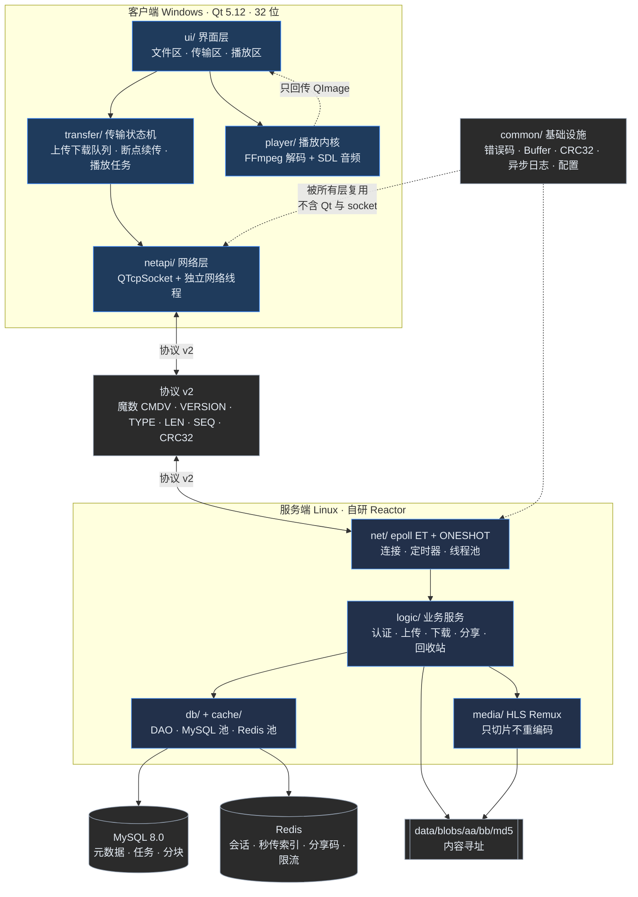
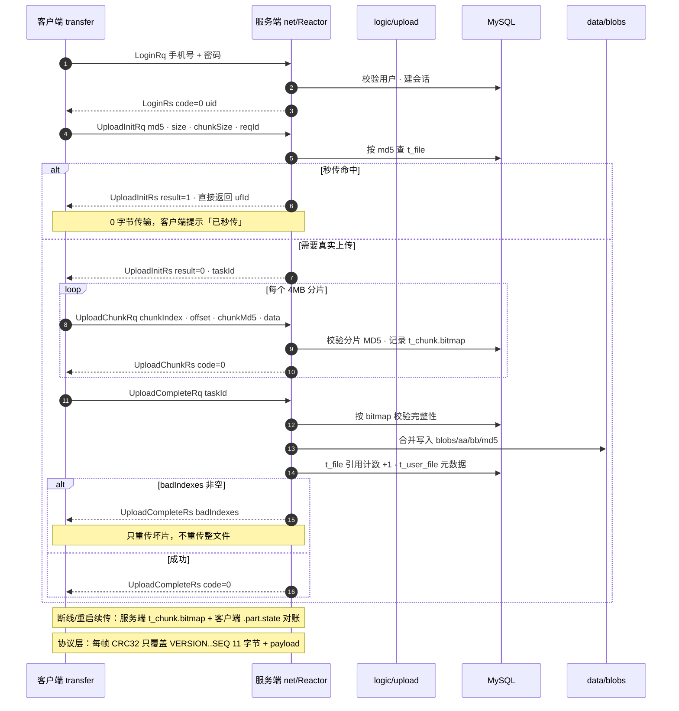
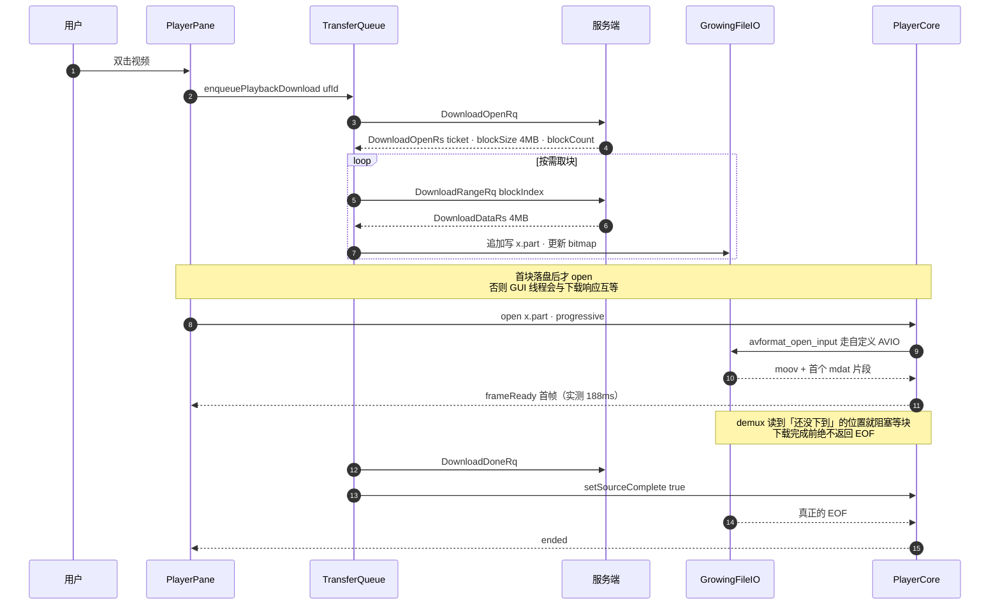

# cloud-media 架构总览

> 一句话：**Windows Qt 客户端 + Linux 自研 Reactor 服务端**，二进制协议 v2，内容寻址存储，
> 支持断点续传、秒传、分享、回收站与边下边播。

本文是给面试官/新同学的入口，三张图 + 两张表。细节在 `docs/specs/`：
01 架构、05 存储、06 业务、08 界面契约、09 播放器。

---

## 1. 分层架构

**依赖红线**（CI 用 grep 卡，违反即失败）：

| 红线 | 要求 | 现状 |
|---|---|---|
| `ui/` 不碰媒体栈 | 不 include `libav*`/`SDL`，只吃 `QImage` | `grep` 为空 |
| `common/` 不碰 Qt / socket | 纯 C++11 + STL | `grep` 为空 |
| `client/` 不依赖 `server/` | 只有协议层共享 | `grep` 为空 |
| `server/` 不碰 Qt | 服务端纯 Linux | 成立 |
| 唯一媒体层 | `client/player/` 才允许 libav/SDL | 成立 |

---

## 2. 上传时序（含秒传 / CRC / 断点续传 / 坏片重传）

要点：

- **秒传**：`t_file` 对 MD5 唯一；命中直接返回 `result=1`，不写盘中转。
- **断点续传**：上传看服务端 `t_chunk.bitmap`（ContinueUploadRq），下载看本地 `.part.state` + `DownloadStatRq` 比对 size/md5。
- **坏片重传**：Complete 返回 `badIndexes`，客户端只补这些分片。
- **CRC**：帧头 CRC 覆盖 11 字节头 + payload；4MB 分片另有 chunkMd5 做内容校验。

---

## 3. 边下边播时序

要点：

- 播放器只认本地 `.part` 路径，不知道网络；进度/完成由 transfer 层信号驱动。
- `GrowingFileIO` 用自定义 `AVIOContext`：读未下载区时阻塞等块（30ms 粒度），complete 后才 EOF。
- `probesize=512KB`、`max_analyze_duration=2s`，避免 open 阶段等还没下到的数据。
- 同步方案（音频主时钟、8ms/120ms 阈值、seek 双屏障）见 `docs/specs/09-播放器设计.md`。

---

## 4. 技术栈

| 层 | 选型 | 说明 |
|---|---|---|
| 服务端 | C++11 · epoll(ET + ONESHOT) · 线程池 | 自研 Reactor，不引第三方网络库 |
| 存储 | MySQL 8.0 · Redis 7 · 本地 blobs | 元数据/任务在 MySQL；会话、秒传、分享码、限流在 Redis |
| 协议 | 自定义二进制 v2 | 19 字节头：魔数 + 版本 + 类型 + 长度 + SEQ + CRC32 |
| 客户端 | Qt 5.12.11（mingw73_32）· QTcpSocket | Model/View，网络独立线程，不阻塞 UI |
| 播放 | FFmpeg 4.2.2 · SDL2 音频 · OpenGL/QPainter | 边下边播，音画同步以音频为主时钟 |
| 构建 | CMake（3.5 语法）· MinGW 7.3 / GCC | C++11 红线；Windows 客户端 32 位 |
| 交付 | Docker 多阶段 · docker compose · windeployqt | 服务端一键起；客户端独立发布目录 |
| 质量 | GoogleTest · ctest 43 项 · GitHub Actions | 含 MySQL/Redis 集成；依赖红线 grep |

---

## 5. 十条关键设计决策

1. **Reactor + epoll ET + ONESHOT**：ET 减少重复事件，ONESHOT 强制"处理完再注册"，避免同一连接被多线程并发读。
   → `docs/specs/01-架构设计.md`
2. **协议 v2 自带魔数 + CRC32**：坏包在解码层就被拒绝，业务层拿到的永远是完整帧；升级不兼容 v1。
   → `docs/specs/02-协议设计.md`
3. **内容寻址存储 + 引用计数**：`blobs/aa/bb/md5` 只存一份，`t_file` 引用计数，多用户同一文件零副本。
   → `docs/specs/05-存储设计.md`
4. **秒传**：上传前按 MD5 命中 `t_file`，直接建用户节点，0 字节传输；界面必须显式提示。
   → `docs/specs/06-业务设计.md`
5. **断点续传用 bitmap**：服务端 `t_chunk.bitmap` 记录已确认分片，客户端 `.part.state` 记录已下载块，重连只补缺。
   → `docs/specs/05-存储设计.md` / `06-业务设计.md`
6. **令牌桶 + 流数上限**：连接级 2MB/s、用户级 8MB/s、全局 512 / 用户 8 条流，超限回 3006，不阻塞工作线程。
   → `docs/specs/06-业务设计.md`
7. **sendfile 零拷贝**：下载块直接内核态发送，10MB 下载裸能力 522MB/s、CPU 15%。
   → `docs/benchmark/压测报告.md`
8. **异步日志**：工作线程只入队，后台线程落盘；压测时日志不是瓶颈（见日志性能报告）。
   → `docs/benchmark/日志性能.md`
9. **音画同步以音频为主时钟**：声卡时钟不可控，视频按 pts 差等待/丢帧；无音频退回系统时钟。
   → `docs/specs/09-播放器设计.md`
10. **C++11 红线**：不用 `make_unique`/`optional`/`string_view`/`filesystem`，保证老工具链（g++ 5.4）可编。
    → `.codebuddy/rules/cpp11-style.md`

---

## 6. 代码地图

| 目录 | 职责 | 关键文件 |
|---|---|---|
| `common/base` | 错误码、Buffer、CRC32、MD5、字节序、时间 | `error_code.h`、`crc32.h` |
| `common/protocol` | 帧结构、编解码、消息结构体 | `codec.h`、`messages/*.h` |
| `common/log` `common/config` | 异步日志、INI 配置 | `logger.h`、`server_config.cpp` |
| `server/net` | Reactor、连接、定时器、线程池 | `event_loop.cpp` |
| `server/logic` | 认证/上传/下载/分享/回收站/播放 | `upload_service.cpp`、`download_service.cpp` |
| `server/db` `server/cache` | DAO、MySQL 池、Redis 池 | `file_dao.cpp`、`redis_pool.cpp` |
| `client/ui` | 三段式界面、对话框、Toast | `MainWindow.cpp`、`PlayerPane.cpp` |
| `client/transfer` | 任务队列与状态机 | `TransferQueue.cpp` |
| `client/netapi` | QTcpSocket + 网络线程 + 帧重组 | `NetWorker.cpp` |
| `client/player` | 解封装/解码/同步/渲染接口 | `PlayerCore.cpp`、`GrowingFileIO.cpp` |
